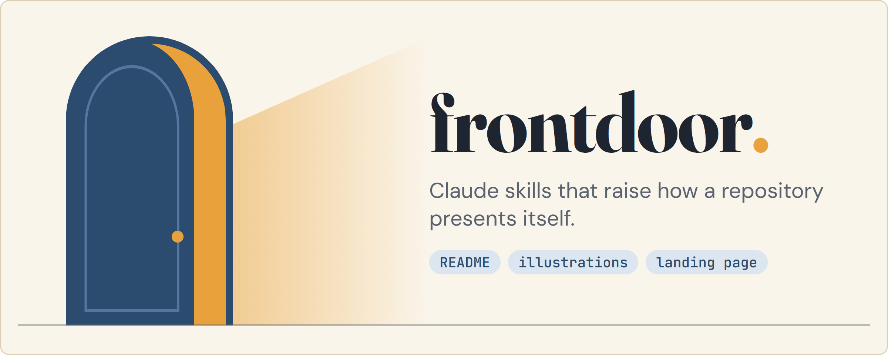
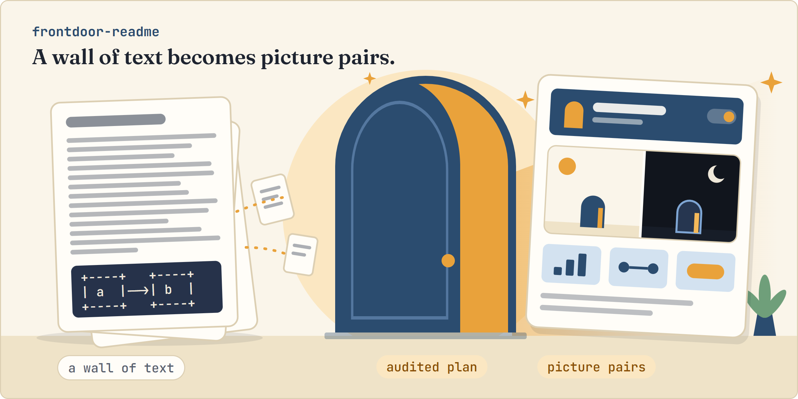
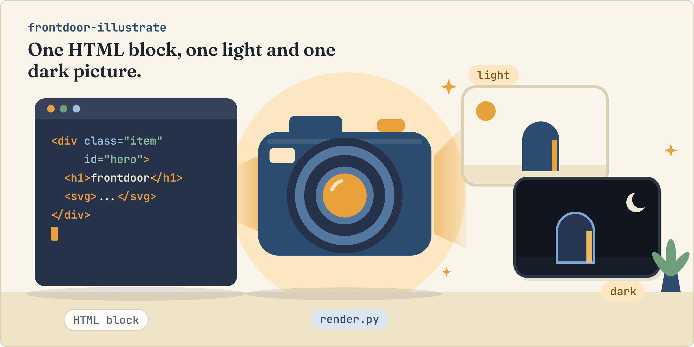
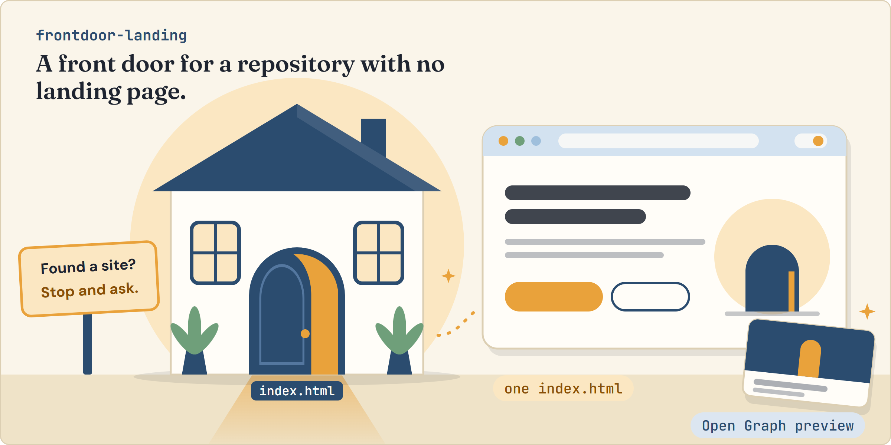

<h1 align="center"><picture><source media="(prefers-color-scheme: dark)" srcset="assets/hero-dark.webp"></picture></h1>

**Claude skills that raise how a repository presents itself: a README built around pictures, illustrations rendered from HTML into light and dark pairs, and a single-file landing page for GitHub Pages.**

## Skills

<picture><source media="(prefers-color-scheme: dark)" srcset="assets/skills-map-dark.webp"></picture>

| Skill | Use it when | Result |
|---|---|---|
| `frontdoor-readme` | the README is missing, or a wall of text, ASCII diagrams or Mermaid | a complete README with a hero banner and `<picture>` light/dark image pairs, in a look drawn from your repository |
| `frontdoor-illustrate` | you need pictures with a look of their own that regenerate from text | rounded, bordered WebP files, one light and one dark per HTML block |
| `frontdoor-landing` | the repository has no landing page and should have one | a single `index.html` with Open Graph preview, checked at three widths in both themes |

Each skill carries its own scripts and references. Install one folder and it works alone. Skills name each other only as optional help.

## How each skill runs

### frontdoor-readme

<picture><source media="(prefers-color-scheme: dark)" srcset="assets/scene-readme-dark.webp"></picture>

It plans before it builds: nothing is rewritten until the plan is approved.

<details>
<summary>Step by step</summary>

<picture><source media="(prefers-color-scheme: dark)" srcset="assets/readme-flow-dark.webp"></picture>

</details>

### frontdoor-illustrate

<picture><source media="(prefers-color-scheme: dark)" srcset="assets/scene-illustrate-dark.webp"></picture>

Every image is an HTML block, so a later edit is a text edit plus one command.

<details>
<summary>Step by step</summary>

<picture><source media="(prefers-color-scheme: dark)" srcset="assets/illustrate-flow-dark.webp"></picture>

</details>

### frontdoor-landing

<picture><source media="(prefers-color-scheme: dark)" srcset="assets/scene-landing-dark.webp"></picture>

It looks for an existing landing page first and stops with its evidence when one counts.

<details>
<summary>Step by step</summary>

<picture><source media="(prefers-color-scheme: dark)" srcset="assets/landing-flow-dark.webp"></picture>

</details>

## Install

Install every skill, or one by name:

```bash
npx skills add https://github.com/the-khiem7/frontdoor.git
npx skills add https://github.com/the-khiem7/frontdoor.git --skill frontdoor-landing
```

Then ask in a plain sentence, for example "make the README nicer to read" or "add a GitHub Pages landing page".

## Requirements

- `uv` and `uvx` to run the scripts (`uvx --from playwright --with pillow python -I ...`).
- Microsoft Edge or Google Chrome already installed. Nothing is downloaded and no administrator rights are needed.
- Node.js with `npx` for the Lighthouse run in `frontdoor-landing`.

## Behaviour to know

- The skills write files and stop. They never commit or push.
- `frontdoor-landing` stops and shows its evidence when it finds an existing landing page, and asks where `index.html` should go before writing.
- No look is shipped. Each repository gets its own signature: a vector shape language, a typeface and a way of presenting, derived from what the project is. Two repositories should not come out as one design with different text.
- `frontdoor-readme` writes the complete README, and every sentence and command traces to the repository or to your answer. Every run ends with a hero banner.
- Where nobody can answer a question, a skill takes the recommended default and writes the question and the assumed answer to `questions.md`.

## Status

<details>
<summary>What was exercised and what was not</summary>

Built and exercised on Windows with Edge. A trial on two real repositories, run with and without the skills, was preferred by a person for both the landing page and the README illustrations. Not yet observed: selection from a plain request, macOS or Linux, a page on its live GitHub Pages URL.

</details>

Scope, decisions and open questions live in [docs/baseline/frontdoor/](docs/baseline/frontdoor/) for the skills and in [docs/baseline/readme-design/](docs/baseline/readme-design/) for the README pictures. The pictures above are rendered from [assets/source/readme.html](assets/source/readme.html) and [assets/source/scenes.html](assets/source/scenes.html).
