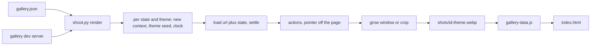

# UI gallery: Topology and Execution Flow

## The skill in this repository

```text
frontdoor-ui-gallery/
  SKILL.md                 the nine-step workflow and the pitfalls
  agents/openai.yaml
  scripts/
    shoot.py               render <gallery.json> [--base] [--only]; check <gallery dir> [--out]
    real.ps1               one open window to PNG with PrintWindow, text matching -Hide painted over (Windows)
  assets/
    gallery.html           the neutral review page (UG-D2), copied to design/ui-gallery/index.html
    mock-kit.ts            caller() (resolve, reject as Error or string, hang), stateName, Mocked<T>
    fixtures.ts            scenario template: base data, scenarios, call, store
    vite.gallery.ts        dev config template: a resolveId plugin from specifier patterns to mock files
  references/
    states.md              how to list states, scenario data rules, observations
    manifest.md            the gallery.json schema
    real-capture.md        screenshots of the built app
    stacks/                index.md, wails3.md, tauri2.md (backend pillar), svelte.md, vue.md (frontend pillar)
```

## What the skill leaves in an app repository

| Path in the app | Holds | Committed |
|---|---|---|
| `<frontend src>/gallery/mock-kit.ts`, `fixtures.ts` | the helpers and the scenarios | yes, by the user |
| `<frontend src>/gallery/mock/<module>.ts` | one typed mock per replaced module | yes, by the user |
| `<vite config dir>/vite.gallery.config.ts` | the dev config that resolves the seam to the mocks | yes, by the user |
| `package.json` | a `gallery` script | yes, by the user |
| `tsconfig.json` | the gallery folder in `include`, when the source folder is not already covered | yes, by the user |
| `design/ui-gallery/gallery.json` | views, states, skipped states, real references | yes, by the user |
| `design/ui-gallery/index.html`, `gallery-data.js`, `shots/`, `real/` | the page, its data, the renders, the built-app screenshots | yes, by the user |

## The three instances

| App | Seam replaced | Mock files | Views and states |
|---|---|---|---|
| `docker-zero` (Wails v3 `beta.30`, Svelte 5) | six generated service modules, matched by `/internal/ui/<service>` | `frontend/gallery/mock/service.ts`, `settingsservice.ts`, `setupservice.ts`, `adoptservice.ts`, `maintainservice.ts`, `uninstallservice.ts` | popup 11, corner box 5, settings 11, maintenance 15, setup 9 |
| `Remotune` (Wails v3 `beta.8`, Vue 3) | the app wrapper `src/wails.ts`, matched by `./wails` | `frontend/gallery/mock/wails.ts` | popup 21, custom effects editor 8 |
| `IRYS-desktop` (Tauri v2, Vue 3) | the wrapper `@/lib/ipc` and `@tauri-apps/api/event` | `src-vue/gallery/mock/ipc.ts`, `event.ts` | settings 12, break overlay 4, break corner card 3 |

## Execution flow of one render



A paused view (`"timers": "paused"`) installs a fake clock before the page loads; every wait then advances it by exactly that many ms (UG-D5).
